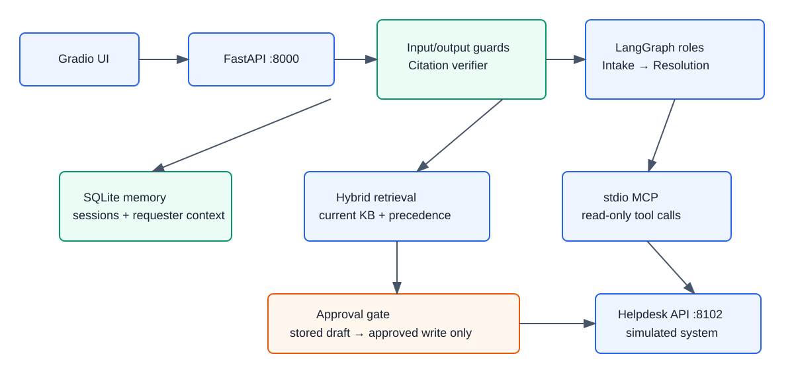

# Nakhla IT Helpdesk Agent — grounded IT support with approval-gated escalation



Nakhla Systems employees get policy-safe IT help from current company knowledge, with citations
for troubleshooting and a ticket created only after they approve its exact draft.

▶ **3-minute demo video:** _Record and add your link before submission_ · 🧪 **Eval pass rate:** 20/20 · 🧰 **Stack:** LangGraph · OpenRouter · MCP · FastAPI · SQLite · Docker Compose

For a component-by-component explanation and workflow diagrams, see the
[implementation guide](docs/IMPLEMENTATION.md).

## What it does

- Resolves documented IT problems from the 20-document Markdown/PDF knowledge base with selected current citations.
- Runs two specialised LangGraph roles: **Intake & Safety** and **Resolution & Escalation**.
- Applies policy precedence, department rules, incidents, and ticket priorities deterministically in Python.
- Remembers session context and requester support history in SQLite across restarts.
- **Asks before it acts:** every ticket is stored as a pending action and written only after explicit approval.

## Architecture

- **Gradio UI → FastAPI contract:** a non-engineer can chat, review citations and approve/reject drafts.
- **Intake & Safety:** uses OpenRouter to extract intent and identify missing context; Python input guards block secret and override attempts before tool access.
- **Resolution & Escalation:** uses OpenRouter with current selected sources; deterministic code verifies precedence and citations.
- **MCP + simulator:** employee directory, status, and tickets are reached only through the supplied stdio MCP server.
- **SQLite memory:** persists conversation state, pending actions, and requester ticket context.
- **Approval gate:** the LLM roles never receive write tools; `/api/approve` calls `create_ticket` with the stored payload and `action_id` idempotency key.

| Component | Real or simulated? | Notes |
|---|---|---|
| OpenRouter chat model | **Real** | `openai/gpt-4.1-mini`; requires your `OPENROUTER_API_KEY` |
| OpenRouter embeddings | **Real** | `openai/text-embedding-3-small` powers persisted semantic vectors and cosine ranking |
| Nakhla Helpdesk API and MCP server | **Simulated** | Bootcamp-supplied REST API + stdio MCP with fault injection |
| Nakhla knowledge base and ticket archive | **Simulated** | Bootcamp-supplied fictional training data |
| SQLite memory | **Local** | Persisted Docker volume / local `data/` directory |

## Run it

```bash
git clone <your-public-repository-url>
cd help-desk-agent
cp .env.example .env
# Add OPENROUTER_API_KEY to .env for real LLM-backed roles.
docker compose up --build
```

Open the UI at **http://localhost:7860**. The API is at **http://localhost:8000** and the
simulated Helpdesk system is at **http://localhost:8102**.

For local development without Docker:

```bash
python -m venv .venv
.venv/bin/python -m pip install -r requirements.txt
.venv/bin/python scripts/ingest_kb.py

# Terminal 1
.venv/bin/python -m uvicorn simulator.services.helpdesk_api:app --port 8102

# Terminal 2
.venv/bin/python -m uvicorn app.main:app --port 8000

# Terminal 3
APP_URL=http://localhost:8000 .venv/bin/python simulator/ui/app_ui.py
```

## How it behaves — the approval gate

The agent returns a ticket as `pending_action` only after it has a schema-valid draft. The UI
shows the exact subject, category, priority, department, attempted steps, and KB references.
Approve calls `/api/approve`; only then does application code call the MCP write tool with the
stored payload and `action_id` as the idempotency key. Rejecting, repeating approval, unknown
actions, and API failures never claim a successful ticket ID.

## Evaluation

| Suite | Passed | Latency |
|---|---:|---|
| Supplied Scenario 2 cases | 10/10 | 1.06 s average, 1.48 s p95 |
| Project-owned cases (`evals/cases.owned.jsonl`) | 10/10 | 0.96 s average, 1.32 s p95 |

The owned suite covers injection, persistent memory, contractor/Finance/Executive rules,
PDF-only grounding, duplicate approval, active incidents, unknown issues, and ticket failures.

**The failure we fixed:** an `NX-403` request initially produced a generic
`review_required` reply instead of the documented KB-002 procedure. The workflow now returns
cited NakhlaKey/VPN-Users guidance and creates a ticket draft only after explicit escalation.
Before → after: unsupported generic reply → grounded response with a regression test.

Run all validations:

```bash
pytest -q
python scripts/ingest_kb.py
python simulator/check_kit.py
python simulator/dataset/validate_dataset.py
python simulator/evals/run_evals.py
python simulator/evals/run_evals.py --cases evals/cases.owned.jsonl
```

## Guardrails and safety

- Blocks direct instruction-override and credential requests before roles or MCP tools run.
- Treats retrieved KB and historical ticket text as data; only current sources can be selected or cited, and draft KB-018 is excluded.
- Rechecks every citation and rejects an output that names an unconfirmed `IT-` identifier.
- Checks live service status before troubleshooting/escalation and reports tool failures honestly.

## Cost and latency

The deterministic validation run measured the latencies above without an OpenRouter key. In
deployed mode, OpenRouter usage is confined to the two JSON role calls per turn; configure a
credit limit on the project key and record model costs from production/demo traces.

## What I’d fix next

- Benchmark the OpenRouter embedding ranking against the deterministic exact-error-code and
  keyword signals on a labelled retrieval-recall set.
- Add authenticated per-employee UI sessions and a user-visible support-history screen.
- Record the final 3-minute demo, add its link above, publish the repository, and complete the
  bootcamp check-in issue comments.

## Team

| | Built |
|---|---|
| **Add team member** | Add ownership and GitHub/LinkedIn link before submission. |
| **Add team member** | Add ownership and GitHub/LinkedIn link before submission. |

## Acknowledgements

Built during the **Agentic AI Bootcamp** — organized by Jerusalem High-Tech Foundry (JHF), in
partnership with COMCEC. The Nakhla Systems data and Helpdesk simulator are fictional
bootcamp-provided training assets.
