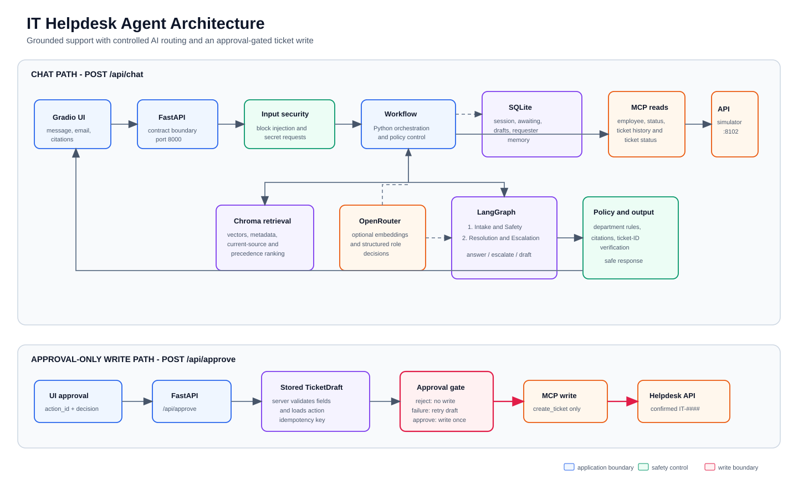
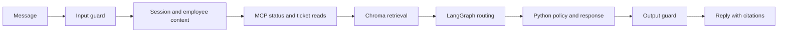
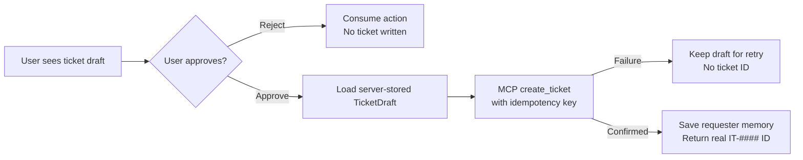

# IT Helpdesk Agent Architecture

This diagram explains how a user message becomes a safe helpdesk response, and why ticket
creation is kept separate from normal chat.



The top lane is the safe **chat path**. The bottom lane is the separate **approval-only ticket
write path**. Red arrows are the only path that can create a ticket.

| Diagram color | Meaning |
|---|---|
| Blue | Application/UI boundary |
| Green | Safety controls |
| Purple | Persistent state and retrieval data |
| Orange | External providers and simulator |
| Red | Approval-gated ticket-write boundary |

## What each part does

| Component | Responsibility |
|---|---|
| **Gradio UI** | Sends the selected employee identity, chat message, and approval decision to FastAPI. |
| **FastAPI** | Provides the two public routes: `/api/chat` and `/api/approve`. |
| **Input guard** | Blocks prompt injection and credential/secret requests before any MCP, retrieval, or LLM call. |
| **SQLite** | Persists session context, follow-up state, server-side drafts, and requester memory. |
| **MCP tools** | Read verified employee, incident, and ticket data; create a ticket only from the approval path. |
| **Chroma** | Stores KB section vectors, source paths, and document-control metadata for semantic retrieval. |
| **LangGraph** | Runs Intake and Safety, then Resolution and Escalation, to produce structured routing decisions. |
| **Python policy** | Applies precedence, department rules, incident handling, validation, and approval constraints. |
| **Output guard** | Allows only current citations and ticket IDs returned by the Helpdesk API. |

## Two separate paths

### 1. Normal chat path



This path can answer, ask for missing context, offer escalation, report an active incident, or
prepare a draft. It **cannot create a ticket**.

### 2. Ticket-write path



The browser never supplies ticket fields for creation. It sends only the stored `action_id` and
an approval decision. This keeps the approval gate enforceable even if a model, user message, or
retrieved document is untrusted.

## Key safety rule

**LangGraph and OpenRouter decide the support route; Python decides what is allowed to happen.**

The LLM roles cannot call MCP tools, create tickets, bypass source precedence, invent citations,
or approve a write.

## Repository file structure

```text
it-helpdesk-agent/
├── app/
│   ├── main.py                 # FastAPI entry point: /api/chat and /api/approve
│   ├── workflow.py             # Main chat orchestration and policy branches
│   ├── agent_graph.py          # Two-role LangGraph definition
│   ├── approval.py             # Approval-only ticket write path
│   ├── guardrails.py           # Input and output safety validation
│   ├── mcp_client.py           # Controlled MCP client and structured logs
│   ├── triage.py               # Error-code, intent, and ticket-query recognition
│   ├── citations.py            # Current-source citation construction
│   ├── models.py               # Pydantic request, response, and TicketDraft contracts
│   ├── config.py               # Paths and environment configuration
│   ├── retrieval/
│   │   ├── search.py           # KB parsing, Chroma persistence, and search
│   │   ├── embeddings.py       # OpenRouter embedding provider
│   │   └── precedence.py       # Source conflict and precedence ordering
│   └── services/
│       ├── sessions.py         # SQLite session, draft, and requester memory store
│       └── llm.py              # OpenRouter role decisions and safe fallback
├── ui/
│   └── app_ui.py               # Project-owned Gradio entry point
├── scripts/
│   └── ingest_kb.py            # Rebuilds the persistent Chroma collection
├── simulator/
│   ├── services/               # Supplied Helpdesk API and MCP server
│   └── dataset/                # Employee, ticket, and KB source data
├── evals/
│   ├── cases.owned.jsonl       # Project-owned evaluation scenarios
│   └── scorecard.*             # Preserved evaluation evidence
├── tests/                      # Unit and workflow regression tests
├── docs/
│   ├── ARCHITECTURE.md         # This overview
│   ├── architecture-overview.svg # Rendered overview diagram
│   ├── IMPLEMENTATION.md       # Detailed implementation guide
│   └── demo-checklist.md       # Demo preparation guide
├── data/
│   ├── chroma/                 # Persistent Chroma collection at runtime
│   └── helpdesk.sqlite3        # Persistent SQLite state at runtime
├── docker-compose.yml          # UI, app, and simulator stack
├── requirements.txt            # Python dependencies
└── README.md                   # Setup, run instructions, and project overview
```
