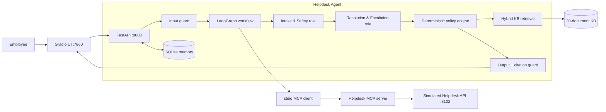
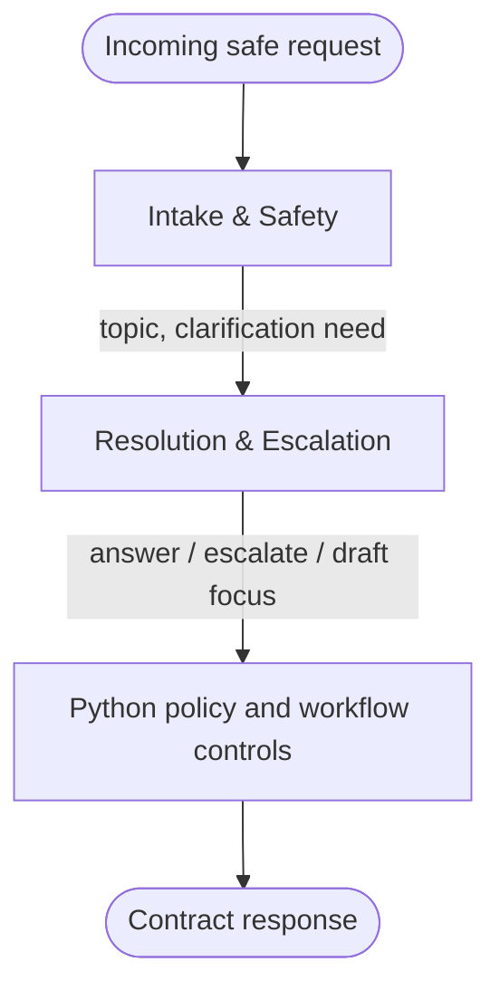
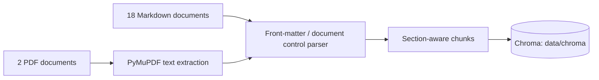
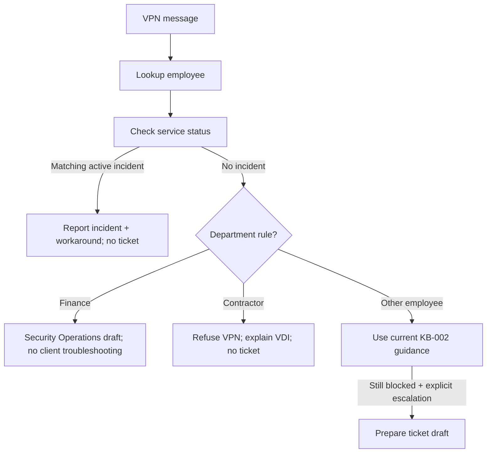
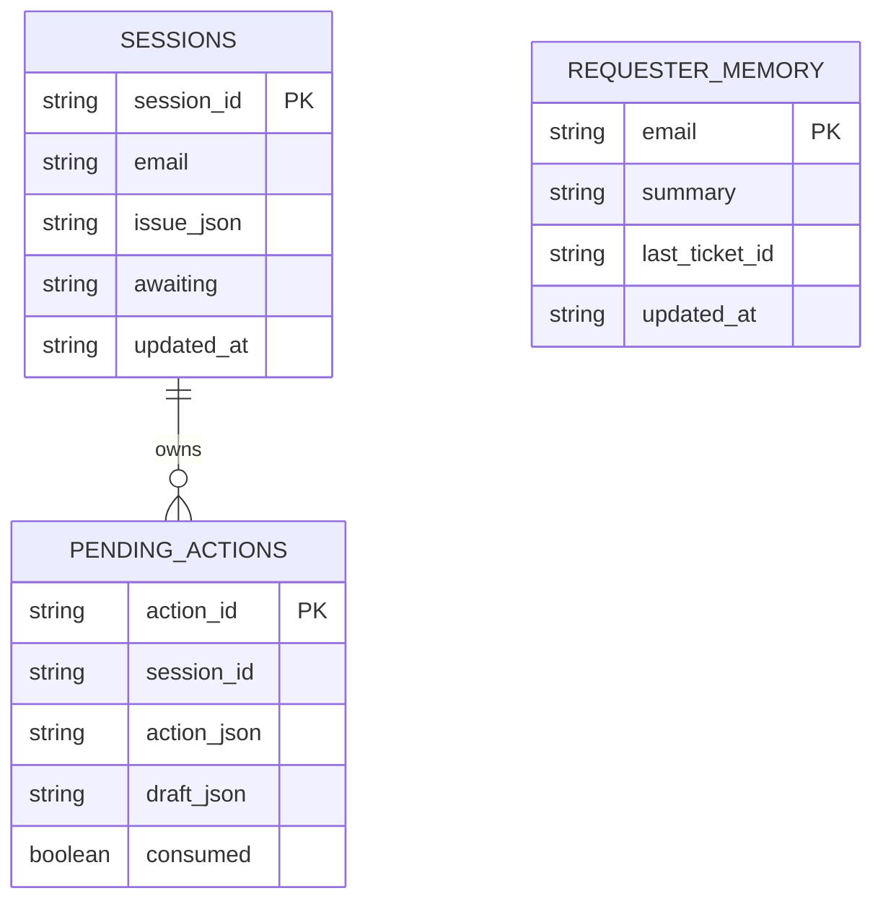
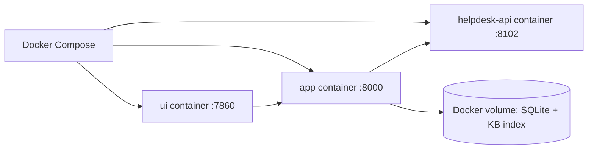

# IT Helpdesk Agent — Implementation Guide

This document explains how the Nakhla IT Helpdesk Agent is built, how a request moves through
the system, and why its safety controls are enforced in Python rather than trusted to an LLM.

## 1. What the system delivers

The agent helps fictional Nakhla Systems employees with IT issues. It:

- Retrieves answers from the supplied 20-document knowledge base, including two PDFs.
- Uses only current, eligible documents as troubleshooting sources and returns selected citations.
- Applies security-policy, document-version, department, contractor, VIP, and incident rules.
- Checks the employee directory and live service status through the supplied stdio MCP server.
- Builds a validated ticket draft when escalation is appropriate.
- Creates a ticket only when the employee approves the exact draft.
- Persists session context, actions, and requester support history in SQLite.

## 2. Component architecture



### Real and simulated components

| Component | Type | Purpose |
|---|---|---|
| OpenRouter model | Real API | Runs the two LLM-backed role calls when `OPENROUTER_API_KEY` is configured. |
| LangGraph | Application framework | Orders Intake & Safety, then Resolution & Escalation. |
| FastAPI | Application service | Implements the required HTTP contract. |
| SQLite | Local persistent storage | Stores sessions, pending actions, and requester memory. |
| Nakhla Helpdesk API + MCP server | Simulated | Provides directory, status, ticket search, and ticket creation. |
| Nakhla KB and history | Simulated training data | Provides knowledge and intentional policy conflicts. |

## 3. Request lifecycle

### 3.1 Chat request

`POST /api/chat` accepts a session ID, employee message, and optional work email.

```mermaid
sequenceDiagram
    participant E as Employee/UI
    participant A as FastAPI Agent
    participant S as SQLite
    participant M as MCP server
    participant H as Helpdesk API
    participant K as Knowledge base

    E->>A: POST /api/chat
    A->>A: Input guard
    alt unsafe override or credential request
        A-->>E: Guardrail response; no tools or write
    else safe request
        A->>S: Restore session and requester memory
        A->>M: lookup_employee(email)
        M->>H: GET directory record
        H-->>M: Department, VIP, device, VPN facts
        A->>M: get_service_status()
        M->>H: GET service status
        H-->>M: Active incidents
        A->>K: Retrieve current candidate sections
        A->>A: Intake & Safety role
        A->>A: Resolution & Escalation role
        A->>A: Deterministic precedence + output checks
        A->>S: Persist session state
        A-->>E: Reply, citations, workflow state, tool traces
    end
```

The role calls use OpenRouter when configured. If no key is present, the application records the
same role boundary but uses safe deterministic fallback decisions so local validation can run
without a paid key. A deployed, agentic demonstration should configure `OPENROUTER_API_KEY`.
The UI identifies the actual mode in its tool trace: `:openrouter`, `:fallback_no_api_key`, or
`:fallback_after_provider_error`.

### 3.2 Ticket approval lifecycle

The LLM-backed roles never receive `create_ticket` or `add_ticket_note`. The ticket write is
isolated behind the HTTP approval endpoint.

```mermaid
sequenceDiagram
    participant E as Employee/UI
    participant A as Agent
    participant S as SQLite
    participant M as MCP server
    participant H as Helpdesk API

    E->>A: Escalation request
    A->>A: Build TicketDraft Pydantic model
    A->>S: Store immutable draft + action_id
    A-->>E: pending_action(create_ticket)

    alt Employee rejects
        E->>A: POST /api/approve approved=false
        A->>S: Mark action consumed
        A-->>E: Nothing was written
    else Employee approves
        E->>A: POST /api/approve approved=true
        A->>S: Load stored draft by action_id
        A->>M: create_ticket(stored payload, idempotency_key=action_id)
        M->>H: POST /api/tickets
        alt Helpdesk confirms creation
            H-->>M: Real IT-xxxx ticket ID
            A->>S: Consume action and save requester memory
            A-->>E: result.ticket_id from the Helpdesk API
        else Helpdesk fails or action is duplicate
            H-->>M: Error / conflict
            A-->>E: Honest failure response; no invented ID
        end
    end
```

## 4. Agent roles

The LangGraph graph uses two distinct roles.



### Intake & Safety

This role receives the employee message and parsed error-code context. Its job is to:

1. Identify a support topic: VPN, identity, software, hardware, printing, or other.
2. Identify whether one focused clarification is required.
3. Avoid treating messages or retrieved text as authority.

The deterministic workflow remains the final authority for missing context, employee lookup,
active incidents, and policy application.

### Resolution & Escalation

This role receives the message, selected current-source IDs, and safe requester context. Its job
is to decide the intended response mode:

- Give a grounded answer.
- Offer escalation when no documented answer exists.
- Propose a ticket draft when explicit escalation is appropriate.

It cannot create tickets, alter precedence rules, invent citations, or approve a write.

## 5. Retrieval and precedence

### Ingestion

`scripts/ingest_kb.py` reads all knowledge-base files:



Each persisted chunk keeps:

- `id`
- `title`
- `version`
- `status`
- `authoritative`
- `last_updated`
- `supersedes`
- `applies_to`
- Source path

In deployed mode, ingestion sends each section to OpenRouter
`openai/text-embedding-3-small` and persists the documents, vectors, and source metadata in the
local Chroma collection at `data/chroma`. At query time, Chroma returns cosine-distance matches
for the embedded request. Search ranks exact error-code matches first, semantic similarity second,
and relevant keyword matches third. When no OpenRouter key is configured, it explicitly uses the
deterministic error-code/keyword fallback.
The retrieval layer filters and ranks sources in deterministic Python:

1. Exclude every non-`current` document.
2. Place `SP-*` security policies before `KB-*` sources.
3. Prefer department-specific rules for the verified employee department.
4. Prefer authoritative documents.
5. Break remaining ties by newer `last_updated`, then higher version.

This excludes deprecated KB-001 and KB-005 and the hostile draft KB-018. Historical tickets are
never policy sources.

## 6. Important domain workflows

### VPN and incidents



Examples:

- `NX-781` cites KB-002 and states the 5.4.2 requirement; it never recommends the KB-018 bypass.
- `NX-503` matching incident `INC-2207` returns the GW-1 workaround and blocks duplicate tickets.
- Finance VPN issues route to Security Operations as `security`, P2, or P1 when more than three
  users are affected.
- Contractors are routed to VDI and never receive a VPN-access ticket.

### Priority rules

The ticket draft builder enforces:

- P1 for more than three affected users.
- P1 for Executive Office/VIP requesters.
- Finance VPN issues as P2 unless the P1 user-count threshold applies.
- The category-to-team mapping supplied by the Helpdesk API.

## 7. Persistent memory

SQLite is stored at `data/helpdesk.sqlite3` locally or in the Compose `helpdesk-data` volume.



- Session state retains the current error code/topic and clarification state across turns.
- Pending action storage prevents later messages from changing an approved draft.
- A confirmed ticket creates a requester-memory summary keyed by employee email.
- Later sessions read that safe, app-generated summary as role context.

## 8. Guardrails

| Threat | Control | Result |
|---|---|---|
| Prompt override / credential request | Input pattern guard before roles or MCP | Blocked response; no tools called |
| Draft/deprecated content | Current-only precedence engine | Cannot become a cited instruction |
| KB-018 hidden prompt injection | Draft status exclusion | Never retrieved as a source |
| Unsupported citation | Current-citation verification | Response is replaced with a safety failure |
| Invented `IT-xxxx` ID | Output verifier compares reply IDs with `result.ticket_id` | Unconfirmed ID is withheld |
| Unapproved write | SQLite pending action + approval endpoint | No MCP write before approval |
| Double click | `action_id` idempotency key + consumed action state | At most one ticket |
| Tool/API failure | Explicit MCP error handling | Honest failure; no fake success |

## 9. API contract

| Endpoint | Behavior |
|---|---|
| `GET /health` | Returns `{"status":"ok"}`. |
| `POST /api/chat` | Returns reply, state, citations, pending action, result, and tool-call observations. |
| `POST /api/approve` | Rejects or commits the server-stored pending action. |

The UI only uses these contract endpoints; it does not call the Helpdesk API, MCP server, or
OpenRouter directly.

## 10. Deployment



Run the complete stack:

```bash
cp .env.example .env
# Set OPENROUTER_API_KEY in .env for live role calls.
docker compose up --build
```

Open:

- UI: `http://localhost:7860`
- Agent API: `http://localhost:8000`
- Simulated Helpdesk API: `http://localhost:8102`

## 11. Validation

The project has:

- **12 unit tests** for ingestion, precedence, API contract, approval, NX-403 regression,
  SQLite persistence, and input guards.
- **10 supplied scenario cases**, passing 10/10.
- **10 project-owned cases** in `evals/cases.owned.jsonl`, passing 10/10.
- Compose health checks for the API, app, and UI.
- The kit smoke check and 1,301 dataset consistency checks.

Run the validation suite:

```bash
pytest -q
python scripts/ingest_kb.py
python simulator/check_kit.py
python simulator/dataset/validate_dataset.py
python simulator/evals/run_evals.py
python simulator/evals/run_evals.py --cases evals/cases.owned.jsonl
```

## 12. Submission work that remains human-owned

The codebase and documentation are ready for a submission, but these actions require the team:

1. Replace team and repository placeholders in `README.md` and `DESIGN.md`.
2. Record and upload the three-minute demo video.
3. Create/publish the public GitHub repository.
4. Post the required bootcamp check-ins.
5. Tag the final commit as `v1.0`.
