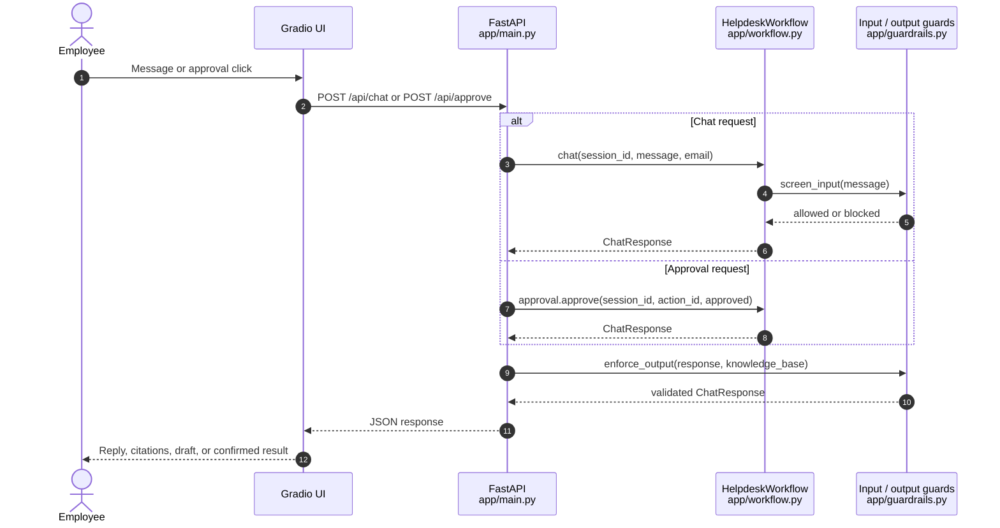
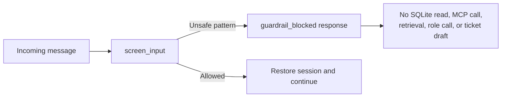
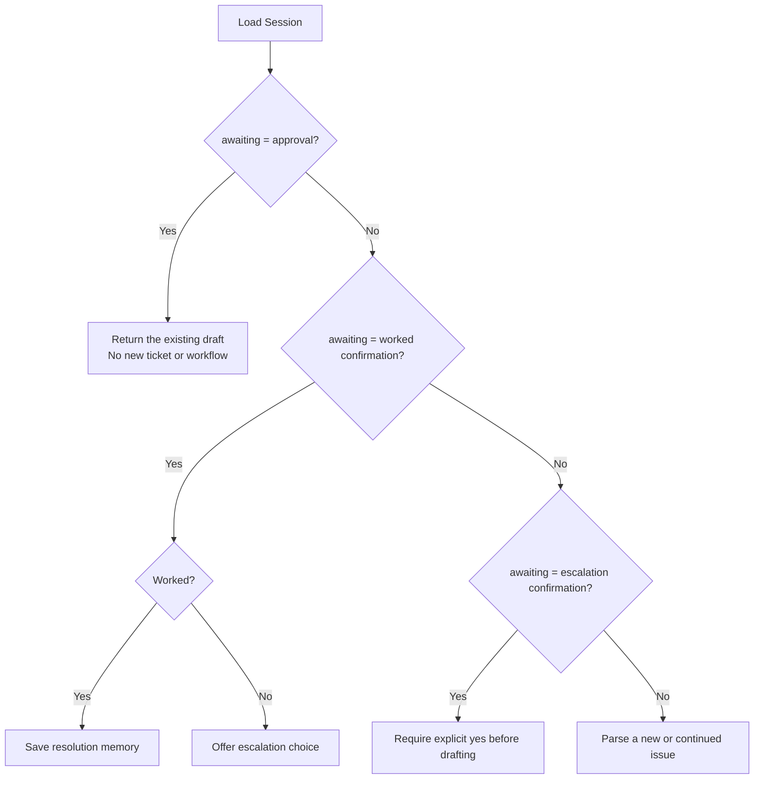
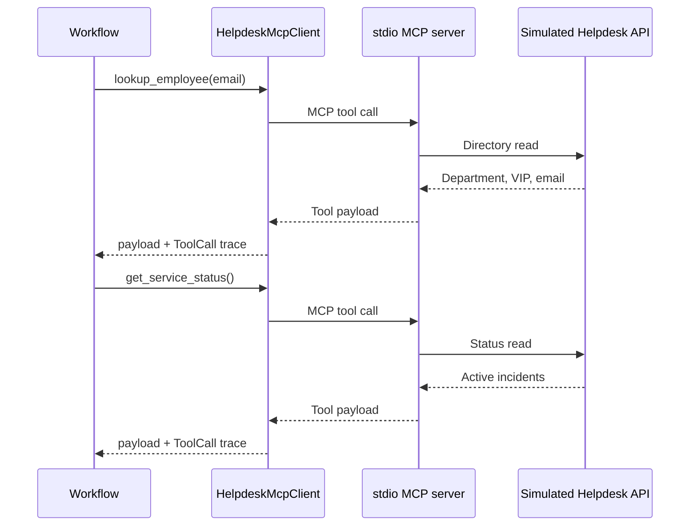
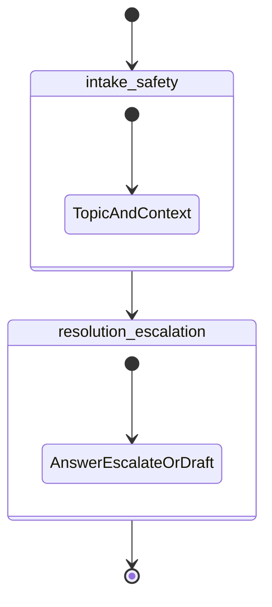
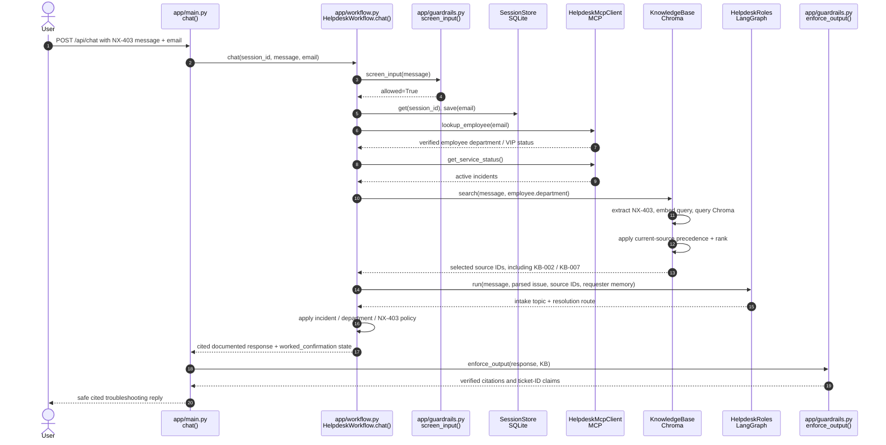
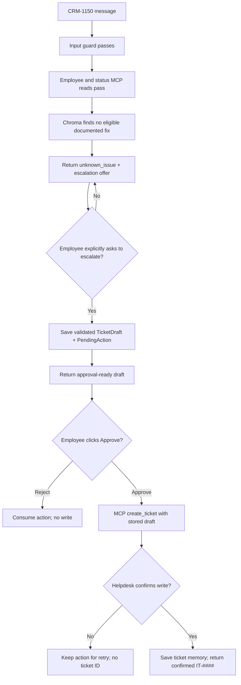
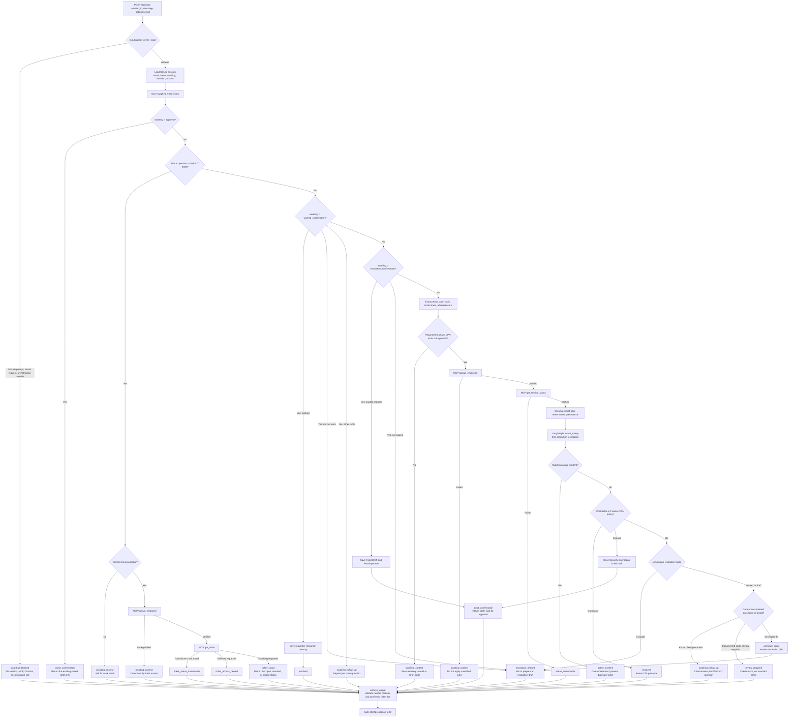
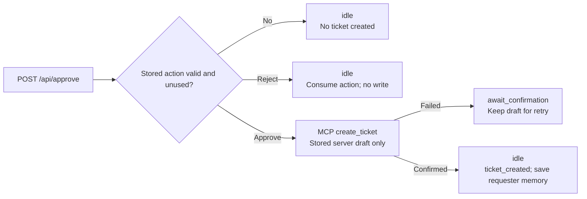

# Request Lifecycle Explained

This document traces both HTTP requests handled by the application:

- `POST /api/chat` — safely understand, retrieve, route, and answer a support request.
- `POST /api/approve` — perform the only permitted ticket write, after explicit user approval.

The UI never calls OpenRouter, Chroma, SQLite, MCP, or the Helpdesk API directly. It calls only
the FastAPI contract in `app/main.py`.

## 1. Request entry points

| Request | FastAPI handler | Input model | Main work |
|---|---|---|---|
| `POST /api/chat` | `app/main.py` → `chat()` | `ChatRequest` | Calls `HelpdeskWorkflow.chat()` and validates the response. |
| `POST /api/approve` | `app/main.py` → `approve_action()` | `ApproveRequest` | Calls `approval.approve()` and validates the response. |
| `GET /health` | `app/main.py` → `health()` | None | Returns service health only. |

`ChatRequest` and `ApproveRequest` are defined in `app/models.py`. Pydantic rejects malformed
request shapes before the handlers run.



## 2. Chat request: complete path

### 2.1 FastAPI receives the request

**Code:** `app/main.py` → `chat()`

1. FastAPI validates the JSON body as `ChatRequest`.
2. The handler extracts `request.user.email` when supplied.
3. It calls `app.state.workflow.chat(session_id, message, email)`.
4. It always passes the workflow response through `enforce_output()` before returning it.

At startup, `app/main.py` → `lifespan()` loads `KnowledgeBase.load_or_build()`. This opens the
persistent Chroma collection at `data/chroma/helpdesk_kb`, or builds it from the KB documents if
it does not exist or is stale.

### 2.2 Input guard runs before any external or model call

**Code:** `app/workflow.py` → `HelpdeskWorkflow.chat()`  
**Guard code:** `app/guardrails.py` → `screen_input()`

The first workflow operation is:

```python
guard = screen_input(message)
guard_trace = ToolCall(tool="input_guard", ok=guard.allowed, ms=0)
```

`screen_input()` compares the lowercased message with `INJECTION_PATTERNS`, including requests to
override instructions or reveal passwords, secrets, or credentials.



If blocked, the workflow returns immediately with `state="guardrail_blocked"` and the
`input_guard` trace. No MCP, Chroma, OpenRouter, or ticket operation occurs.

### 2.3 Restore durable session state

**Code:** `app/services/sessions.py` → `SessionStore.get()`  
**Called by:** `app/workflow.py` → `HelpdeskWorkflow.chat()`

SQLite at `data/helpdesk.sqlite3` restores:

| Stored data | Why it is needed |
|---|---|
| `email` | Keeps the employee identity across turns. |
| `issue` | Retains the original error code, topic, message, and KB references. |
| `awaiting` and `decision` | Continues a follow-up, escalation choice, or approval state safely. |
| `pending_actions` | Holds the server-owned ticket draft and consumed flag. |
| `requester_memory` | Stores app-generated prior resolution/ticket context by email. |

The workflow handles an existing decision before treating a message as a new issue:



### 2.4 Validate required context

**Code:** `app/workflow.py` → `extract_issue()` call and missing-context branches  
**Parser:** `app/triage.py` → `extract_issue()`

The workflow extracts an error code, topic, ticket intent, and affected-user count. It then stops
and asks for missing information when needed:

- A vague VPN request without an error code enters `missing_context` / `error_code`.
- A request without an employee email enters `missing_context` / `email`.

This prevents the app from applying department policy or supplying troubleshooting before it can
identify the employee and issue safely.

### 2.5 Read employee and live status through MCP

**Code:** `app/mcp_client.py` → `HelpdeskMcpClient`  
**Called by:** `app/workflow.py` → `lookup_employee()` and `get_service_status()`



`HelpdeskMcpClient.call()` measures latency, creates a `ToolCall`, and emits a sanitized JSON
application log with `tool`, `ok`, `latency_ms`, and `error_code`. It does not log the request
arguments, so it avoids logging the employee email or draft contents.

If either read fails, the workflow returns an honest response and does not provide
troubleshooting or create a ticket.

### 2.6 Retrieve eligible knowledge-base evidence from Chroma

**Code:** `app/retrieval/search.py` → `KnowledgeBase.search()`  
**Precedence code:** `app/retrieval/precedence.py` → `eligible()`

At ingestion time, `scripts/ingest_kb.py` calls `KnowledgeBase.build()` and `persist()`:

1. Reads Markdown and PDF source files.
2. Parses YAML document-control metadata.
3. Splits each source into heading-aware sections.
4. Sends each section to OpenRouter embeddings when a key is configured.
5. Writes section text, vectors, metadata JSON, and source path into the local Chroma collection
   named `helpdesk_kb`.

At chat time:

```mermaid
flowchart LR
    Q[Employee message] --> E[Extract exact error codes<br/>and keywords]
    Q --> V[OpenRouter query embedding]
    V --> C[Chroma cosine search]
    E --> R[Deterministic ranking]
    C --> R
    R --> P[eligible()]
    P --> O[Current, applicable,<br/>precedence-ranked chunks]
```

`KnowledgeBase.search()` applies these signals:

1. **Exact error-code match** — strongest signal, such as `NX-403`.
2. **Chroma cosine similarity** — finds semantically similar wording.
3. **Keyword overlap** — supports deterministic local fallback.

`eligible()` applies policy precedence:

1. Excludes non-current documents.
2. Prioritizes `SP-*` security policies.
3. Prioritizes a verified department-specific source.
4. Prefers authoritative, newer, higher-version documents.

Deprecated and draft content cannot become cited evidence.

### 2.7 Run the two LangGraph roles

**Code:** `app/agent_graph.py` → `HelpdeskRoles`  
**Model boundary:** `app/services/llm.py` → `OpenRouterRoles`



| Role | Receives | Returns | Cannot do |
|---|---|---|---|
| Intake & Safety | Message, parsed topic, error code | Safe topic and context need | Read/write MCP tools, policy override |
| Resolution & Escalation | Message, intake topic, selected source IDs | `answer`, `escalate`, or `draft` mode | Ticket creation, citation invention, approval |

If OpenRouter is unavailable, `OpenRouterRoles` returns deterministic fallback decisions and a
tool trace identifying the fallback. The roles influence safe response routing, but they are not
the final policy authority.

### 2.8 Apply deterministic policy and return a safe next step

**Code:** `app/workflow.py` → policy branches after `roles.run()`

Python evaluates the trusted employee/status data, retrieved evidence, role route, and persisted
state. These branches include:

| Situation | Workflow action |
|---|---|
| Active service incident | Returns incident ID and documented workaround; no duplicate ticket. |
| Contractor VPN | Refuses VPN access and points to VDI; no ticket. |
| Finance VPN | Creates a Security Operations **draft**; no client troubleshooting. |
| Known documented issue | Returns cited procedure and records `worked_confirmation`. |
| Procedure worked | Saves requester resolution memory and ends the loop. |
| Procedure failed | Offers escalation; waits for explicit confirmation. |
| Explicit confirmed escalation | Creates a server-stored `TicketDraft`; still no ticket. |
| Unknown issue | Explains no documented fix and offers escalation; no invented steps. |

The `_draft()` helper in `app/workflow.py` constructs a `TicketDraft`, creates a
`PendingAction`, saves both to SQLite, and returns `state="await_confirmation"`.

`TicketDraft` in `app/models.py` is intentionally strict:

- Unknown fields are forbidden.
- Category and priority are constrained values.
- Requester email must be a Nakhla address.
- Attempted steps and KB reference format are validated.

### 2.9 Worked example: find relevant information for an NX-403 message

This section follows one ordinary troubleshooting request from the user’s message to the final
cited reply:

```text
My VPN shows NX-403. What should I do?
```



#### Step-by-step code trace

| Step | Exact code location | What happens |
|---|---|---|
| 1. HTTP validation | `app/main.py` → `chat()` | FastAPI validates the body as `ChatRequest`, extracts `user.email`, and calls `workflow.chat()`. |
| 2. Input safety | `app/workflow.py` → `HelpdeskWorkflow.chat()`; `app/guardrails.py` → `screen_input()` | The message is screened before any database, retrieval, model, or MCP operation. A rejected message returns immediately. |
| 3. Issue parsing | `app/triage.py` → `extract_issue()` | The regular expression extracts `NX-403`; the code classifies it as a VPN issue and detects whether the user explicitly requested a ticket. |
| 4. Durable context | `app/services/sessions.py` → `SessionStore.get()` / `save()` | The app loads any previous issue/follow-up state, saves the supplied email, and keeps the conversation associated with the session ID. |
| 5. Employee information | `app/workflow.py` → `client.lookup_employee()`; `app/mcp_client.py` → `lookup_employee()` | MCP retrieves the employee record. The workflow now knows the verified department and VIP status required for later policy decisions. |
| 6. Live incident information | `app/workflow.py` → `client.get_service_status()` | MCP retrieves active incidents. If NX-403 were part of an active incident, the incident branch would return before normal troubleshooting. |
| 7. Find KB candidates | `app/workflow.py` → `self.kb.search(message, employee["department"])` | The workflow asks the KB only after identity and status reads succeed. |
| 8. Exact + semantic retrieval | `app/retrieval/search.py` → `KnowledgeBase.search()` | It extracts `NX-403`, creates a query embedding when OpenRouter is configured, asks Chroma for semantic candidates, and combines exact-code, semantic, and keyword scores. |
| 9. Evidence eligibility | `app/retrieval/precedence.py` → `eligible()` | It removes non-current documents and ranks security policy, department applicability, authority, recency, and version deterministically. This prevents a draft or deprecated source from becoming evidence. |
| 10. Role routing | `app/agent_graph.py` → `HelpdeskRoles.run()` | Intake confirms/refines the VPN topic. Resolution chooses a safe response route; it cannot invoke MCP or create tickets. |
| 11. Deterministic NX-403 handling | `app/workflow.py` → `if issue.code == "NX-403"` | Python—not the role—selects the documented NakhlaKey/VPN-Users guidance and chooses `KB-002` and `KB-007` as citations. If the user had explicitly requested a ticket and the safe route were `draft`, Python would create only a pending draft. |
| 12. Follow-up persistence | `app/workflow.py` → `_documented_response()` | The response is stored with `awaiting="worked_confirmation"`, the original message, issue, and KB references. The reply asks whether the procedure resolved the problem. |
| 13. Final response safety | `app/main.py` → `enforce_output()`; `app/guardrails.py` → `valid_citations()` | Every citation must resolve to a current source. Any unconfirmed `IT-####` identifier is removed before the response is serialized back to the UI. |

#### What the user receives

The final `ChatResponse` contains:

```json
{
  "session_id": "the existing session ID",
  "state": "awaiting_follow_up",
  "reply": "NX-403 means access was denied... Did that resolve the issue?",
  "citations": ["KB-002", "KB-007"],
  "pending_action": null,
  "tool_calls": ["input_guard", "lookup_employee", "get_service_status", "roles", "output_guard"]
}
```

The citation objects contain IDs and titles in the actual API response; the JSON above is a
shortened conceptual example. A ticket is still not created. If the user says it did not work,
the next message moves the persisted session into the explicit escalation-choice path.

## 3. Approval request: the only ticket-write path

### 3.1 Approval sequence

**FastAPI handler:** `app/main.py` → `approve_action()`  
**Business logic:** `app/approval.py` → `approve()`

```mermaid
sequenceDiagram
    autonumber
    actor Employee
    participant UI as Gradio UI
    participant API as POST /api/approve
    participant A as approval.approve()
    participant DB as SQLite pending_actions
    participant MCP as HelpdeskMcpClient
    participant HD as Simulated Helpdesk API
    participant Guard as enforce_output()

    Employee->>UI: Click Approve or Reject
    UI->>API: session_id, action_id, approved
    API->>A: approve(...)
    A->>DB: get_action(session_id, action_id)

    alt Unknown or consumed action
        DB-->>A: None or consumed
        A-->>API: No ticket created
    else Rejected
        A->>DB: Mark action consumed
        A-->>API: Nothing written
    else Approved
        A->>MCP: create_ticket(stored draft, action_id)
        MCP->>HD: MCP / ticket create
        alt Write failed
            HD-->>MCP: Error
            MCP-->>A: Failed payload and trace
            A->>DB: Keep action unconsumed for retry
            A-->>API: Honest retryable failure
        else Write confirmed
            HD-->>MCP: Confirmed IT-#### ticket
            MCP-->>A: Confirmed payload and trace
            A->>DB: Consume action; save requester memory
            A-->>API: Confirmed ticket result
        end
    end

    API->>Guard: Validate output
    Guard-->>UI: Safe JSON response
```

### 3.2 Why the browser cannot create a ticket on its own

The browser sends only:

```json
{
  "session_id": "…",
  "action_id": "act-…",
  "approved": true
}
```

It does **not** send a ticket subject, category, priority, KB references, or description that the
server accepts for writing. `approval.approve()` loads the stored draft with
`sessions.get_action()`, then calls:

```python
client.create_ticket(stored.draft.model_dump(), action_id)
```

The `action_id` is the MCP idempotency key. A consumed action cannot create a second ticket. A
failed write stays unconsumed so the same approved draft can be retried safely.

## 4. Final output validation

**Code:** `app/guardrails.py` → `enforce_output()`  
**Called by:** both route handlers in `app/main.py`

Before FastAPI returns either chat or approval output:

1. `valid_citations()` checks that every cited ID exists in the loaded KB and is `current`.
2. If citations fail, the response is replaced with a safe unsupported-guidance message.
3. The guard scans the reply for `IT-####`.
4. A mentioned ticket ID is allowed only when it matches `response.result.ticket_id` returned from
   the Helpdesk API.
5. The guard appends an `output_guard` `ToolCall` for UI observability.

## 5. Short trace: unknown CRM issue

This is the safe CRM-1150 escalation journey:



## 6. Code map

| Concern | Primary location | Key symbol |
|---|---|---|
| HTTP contract and final output guard | `app/main.py` | `chat()`, `approve_action()` |
| Input and output guardrails | `app/guardrails.py` | `screen_input()`, `enforce_output()` |
| Chat orchestration and policy branches | `app/workflow.py` | `HelpdeskWorkflow.chat()` |
| Draft creation | `app/workflow.py` | `_draft()` |
| Role graph | `app/agent_graph.py` | `HelpdeskRoles` |
| OpenRouter role calls | `app/services/llm.py` | `OpenRouterRoles` |
| Chroma ingestion and query ranking | `app/retrieval/search.py` | `KnowledgeBase` |
| Source precedence | `app/retrieval/precedence.py` | `eligible()` |
| MCP communication and structured logs | `app/mcp_client.py` | `HelpdeskMcpClient.call()` |
| SQLite session and action persistence | `app/services/sessions.py` | `SessionStore` |
| Approval-only write gate | `app/approval.py` | `approve()` |
| API data models | `app/models.py` | `ChatRequest`, `ApproveRequest`, `TicketDraft` |

## 7. Complete request state flow

The diagram below shows every chat-path state. Every arrow that returns a response passes through
`enforce_output()` in `app/main.py` before the UI receives it. This final guard verifies citations
and prevents an unconfirmed `IT-####` ticket ID from being shown.



### 7.1 Approval state is a separate write-only flow

`await_confirmation` means a draft exists, not that a ticket exists. The UI must call
`POST /api/approve` with the stored `action_id`:



### 7.2 Response states and their meaning

| API `state` | Meaning |
|---|---|
| `guardrail_blocked` | Input was unsafe; no downstream call ran. |
| `awaiting_context` | Email or error code is required before safe processing. |
| `awaiting_follow_up` | A cited procedure was returned; the app waits for Worked? confirmation. |
| `escalation_offered` / `unknown_issue` | The app needs explicit consent before drafting an escalation. |
| `await_confirmation` | A server-stored ticket draft is waiting for approval or retry. |
| `active_incident` | Live service status matched the issue; show the workaround instead of creating a duplicate. |
| `resolved` | A policy path or successful Worked? follow-up completed the issue. |
| `review_required` | A current source was found, but the workflow will not invent procedure details. |
| `status_unavailable` | The live service-status MCP read failed. |
| `ticket_status` | A verified requester received the live status for their own ticket. |
| `ticket_status_unavailable` | The ticket-status MCP read failed or found no ticket. |
| `ticket_access_denied` | The requested ticket belongs to a different employee. |
| `idle` | Approval endpoint finished, rejected, or found an invalid/consumed action. |
